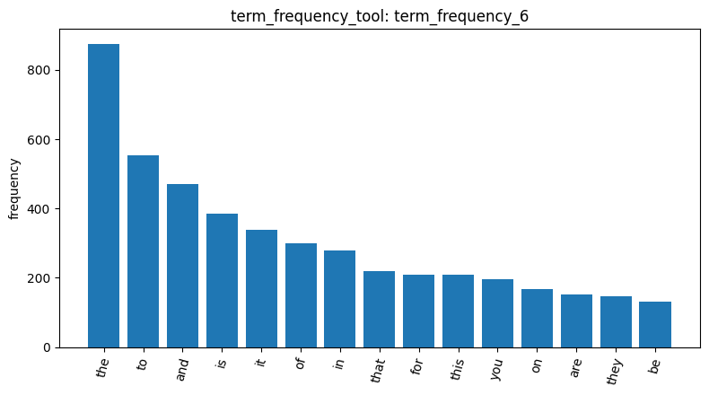
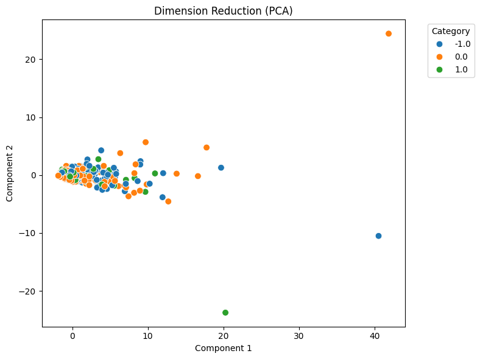
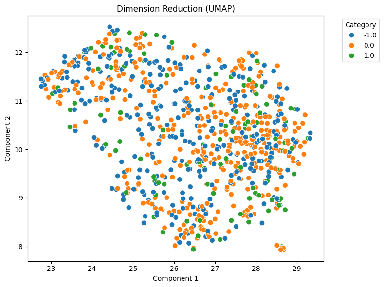

# Homework Report — Reddit Stock Sentiment

## 1. Data Loading and Cleaning

The Reddit Stock Sentiment dataset contains 847 posts, with three sentiment labels [load_dataset_1]:

* Neutral: 423 posts (approximately 50%)
* Negative: 315 posts (approximately 37%)
* Positive: 109 posts (approximately 13%)

The dataset is imbalanced because neutral posts make up approximately half of the data, while positive posts represent only 13%. This matches my initial prediction.
The missing-value check found 0 missing values out of 847 posts [check_missing_2], so no missing-data removal was necessary.
The duplicate check identified 23 duplicate posts [check_duplicates_3], compared with zero duplicates in the 20 Newsgroups dataset. These duplicates were identified by comparing both the post text and its label, meaning the repeated posts had the same sentiment labels.
I then enabled duplicate removal [check_duplicates_4]. A total of 34 rows were removed, leaving 813 posts. This happened because the `keep=False` option removes every occurrence of a duplicated entry rather than keeping one copy.
I removed these posts because reposts and bot-generated content can inflate word counts without necessarily representing genuine individual opinions. However, this also has a trade-off: some positive posts may be removed, potentially reducing an already small positive class.

## 2. Document-Term Matrix and Term Frequency

After cleaning, the document-term matrix contained 813 documents and 4,313 terms [build_dtm_5].
It had 16,659 non-zero entries, with approximately 99.52% sparsity. This means each post contained only around 20 distinct words on average, showing that the Reddit posts were relatively short.
The 20 most frequent terms were mostly common English words [term_frequency_6]. The top five were:

1. the — 874
2. to — 554
3. and — 471
4. is — 386
5. it — 338

All 20 of the top terms were stopwords. Like the 20 Newsgroups dataset, there were no topic-related words among the top 20. However, the Reddit dataset was even more extreme, with 20 out of 20 terms being stopwords, compared with 19 out of 20 in 20 Newsgroups. Interestingly, words such as "he" and "will" also appeared frequently.

## 3. PCA

The PCA visualization showed that the three sentiment labels were heavily mixed together, forming one main clump near the origin, with a few outliers located farther away [reduce_dimensions_7]. This matched my initial prediction that the sentiment categories would overlap.
The first principal component (PC1) explained 26.7% of the variance, while the second principal component (PC2) explained 5.12%.
Compared with the 20 Newsgroups dataset, where PC1 explained 65.94% of the variance, the Reddit dataset had a much lower percentage.
One possible explanation is that Reddit posts are generally short, so differences in document length may have less influence on the main principal component. However, this is only a hypothesis and would require further investigation.
I also questioned the agent's suggestion that sentiment information must lie in higher dimensions. The PCA visualization alone does not establish this. Although the first two components do not clearly separate the labels, this does not prove where sentiment information is located.

## 4. UMAP

The UMAP visualization produced an evenly distributed cloud of points, with all three sentiment labels mixed together [reduce_dimensions_8]. There were no clearly separated groups or clusters.
Although the agent described the visualization as having "three sentiment clusters," I disagreed with this interpretation because the points actually formed one mixed cloud rather than three distinct groups.
This was different from the 20 Newsgroups dataset, where some topic-based groupings could be observed in the UMAP visualization.
The result suggests that sentiment labels are not easily distinguishable through this two-dimensional representation. Unlike topic categories, sentiment may be more difficult to separate based only on the overall distribution of words.

## 5. Conclusion

Overall, the Reddit Stock Sentiment dataset was relatively short, sparse, and imbalanced. Unlike the 20 Newsgroups dataset, it contained duplicate posts and did not show clear sentiment-based separation in either PCA or UMAP.
The PCA results showed that the first two components explained relatively little of the total variance, while UMAP displayed one mixed cloud without distinct clusters. These visualizations suggest that the three sentiment labels are difficult to distinguish using these two-dimensional representations alone.
If I continued this analysis, I would investigate whether additional text preprocessing, sentiment-specific features, or supervised classification methods could help distinguish the three sentiment categories. I would also examine the effect of removing duplicates on the class distribution, especially because the positive class is already relatively small.
